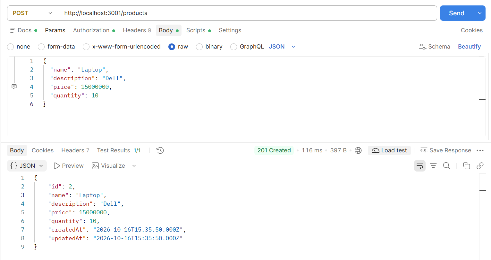
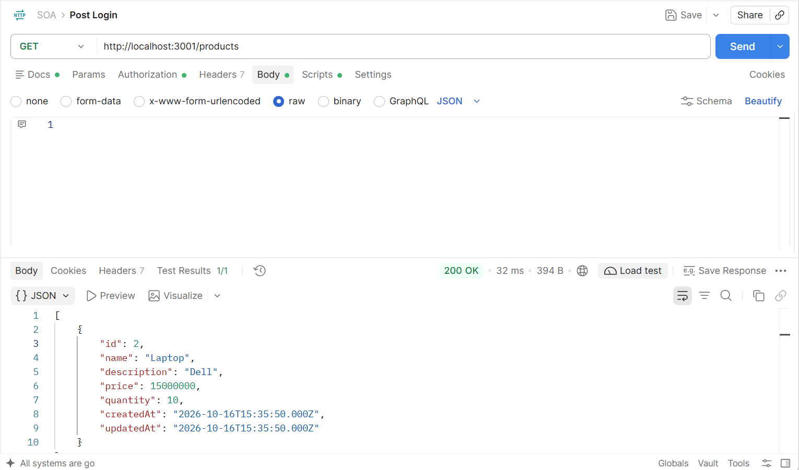
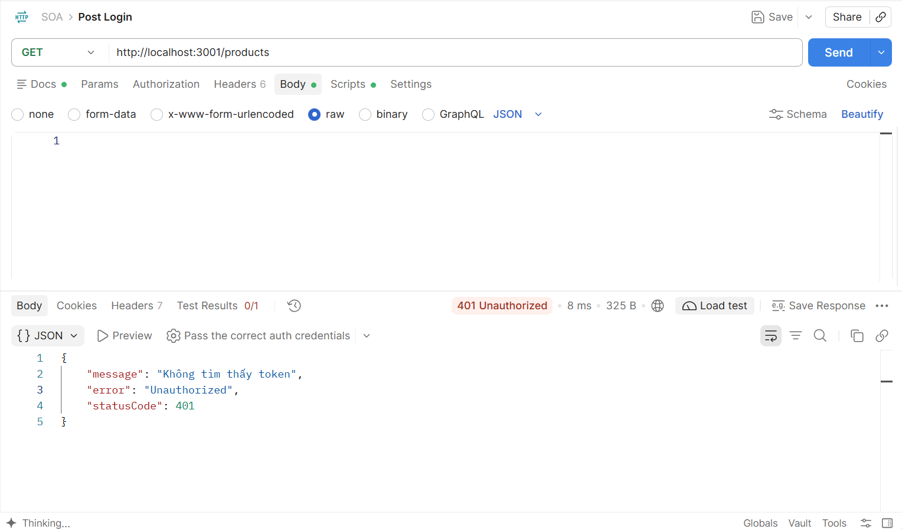

# BÁO CÁO BÀI THỰC HÀNH SỐ 3

## Xây dựng dịch vụ quản lý sản phẩm (Product Management)

## 1. Mục tiêu

- Xây dựng dịch vụ quản lý sản phẩm (tạo, xem, cập nhật, xóa).
- Dịch vụ chạy độc lập trên một cổng và cơ sở dữ liệu riêng (theo nguyên tắc SOA).
- Xác thực thông qua dịch vụ đã xây dựng ở bài thực hành số 2.

## 2. Công nghệ

NestJS (TypeScript), MySQL, TypeORM, Postman.

## 3. Tính độc lập của dịch vụ

| Dịch vụ          | Cổng | Cơ sở dữ liệu                   |
| ---------------- | ---- | ------------------------------- |
| Xác thực (bài 2) | 3000 | Database của bài 2 (bảng users) |
| Sản phẩm (bài 3) | 3001 | product_db (bảng products)      |

- Cổng riêng: cấu hình `PORT=3001` trong `.env`, dùng ở `main.ts`.
- Cơ sở dữ liệu riêng: kết nối `product_db` trong `app.module.ts`, chỉ làm việc với bảng `products`.
- Hai dịch vụ chỉ giao tiếp qua API HTTP, không chia sẻ mã nguồn hay dữ liệu.

## 4. Cơ sở dữ liệu

Bảng `products` trong `product_db` (script: [database/product_db.sql](database/product_db.sql)):

| Tên cột     | Kiểu dữ liệu      | Mô tả                    |
| ----------- | ----------------- | ------------------------ |
| id          | INT (PRIMARY KEY) | ID duy nhất của sản phẩm |
| name        | VARCHAR(255)      | Tên sản phẩm             |
| description | TEXT              | Mô tả sản phẩm           |
| price       | DECIMAL(10, 2)    | Giá sản phẩm             |
| quantity    | INT               | Số lượng trong kho       |
| created_at  | TIMESTAMP         | Ngày tạo                 |
| updated_at  | TIMESTAMP         | Ngày cập nhật lần cuối   |

## 5. RESTful API

| Phương thức | Đường dẫn     | Chức năng                 |
| ----------- | ------------- | ------------------------- |
| GET         | /products     | Lấy danh sách sản phẩm    |
| GET         | /products/:id | Lấy chi tiết một sản phẩm |
| POST        | /products     | Thêm sản phẩm mới         |
| PUT         | /products/:id | Cập nhật sản phẩm         |
| DELETE      | /products/:id | Xóa sản phẩm              |

Tất cả API yêu cầu header `Authorization: Bearer <token>`.

## 6. Xác thực qua dịch vụ bài 2

`AuthMiddleware` (`src/auth/auth.middleware.ts`) được gắn cho các route `/products`. Với mỗi yêu cầu, middleware gọi `POST http://localhost:3000/auth` sang dịch vụ bài 2 để kiểm tra token:

- Hợp lệ: cho đi tiếp tới Controller.
- Không có token hoặc token sai: trả về 401.
- Không kết nối được dịch vụ xác thực: trả về 503.

Dịch vụ sản phẩm không giữ khóa bí mật JWT và không tự giải mã token.

## 7. Kết quả kiểm thử (Postman)

| Trường hợp            | Kết quả |
| --------------------- | ------- |
| POST /products hợp lệ | 201     |
| GET /products         | 200     |
| GET /products/1       | 200     |
| PUT /products/1       | 200     |
| DELETE /products/1    | 200     |
| Không có token        | 401     |
| Token sai             | 401     |
| GET /products/999     | 404     |
| POST với price âm     | 400     |

## 8. Kết luận

Đã xây dựng dịch vụ quản lý sản phẩm với đủ 5 API, chạy độc lập ở cổng 3001 với cơ sở dữ liệu riêng, và xác thực bằng cách gọi dịch vụ ở bài thực hành số 2 qua HTTP.
